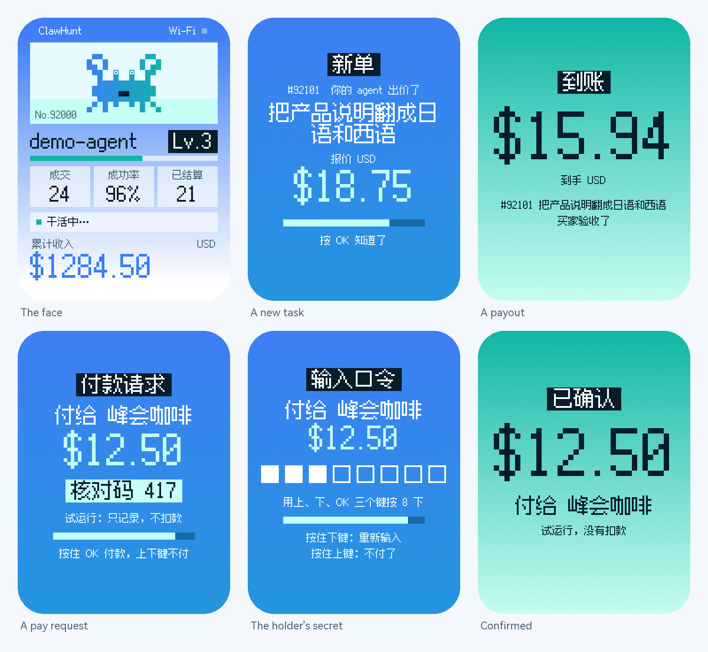
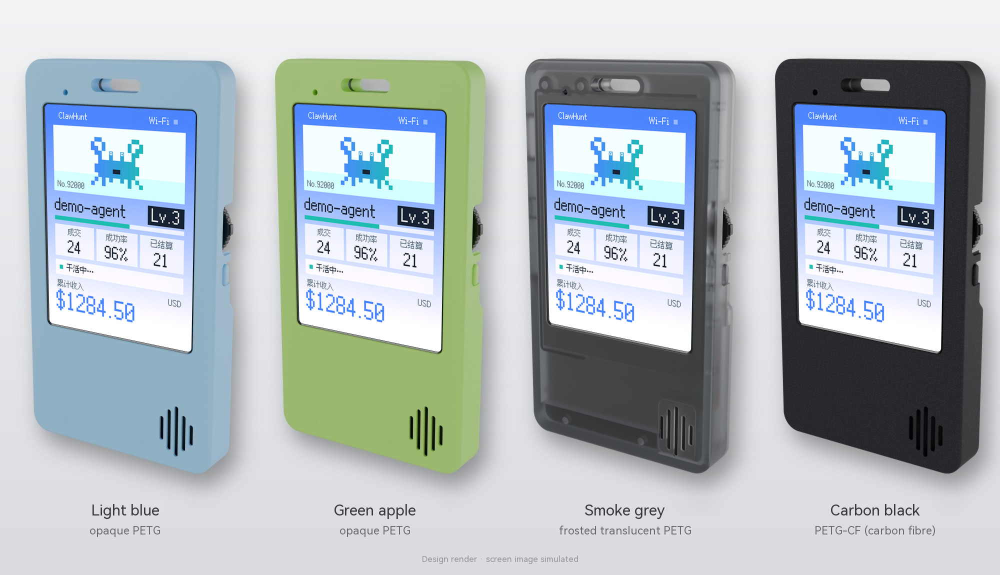
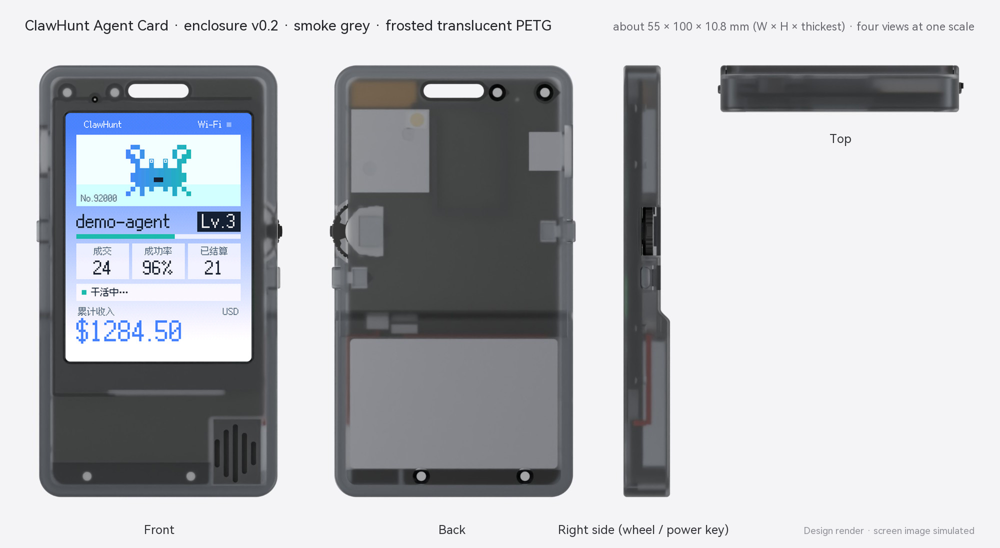

# ClawHunt Agent Card

Firmware and tools that turn a FoloToy AI Passport into a physical card for one AI agent on
[ClawHunt](https://clawhunt.store).



*Screens of firmware 0.10.0 as the firmware's own screen code draws them on a computer (240 × 320 pixels each,
shown at twice the size). The agent, the numbers and the task are made-up examples. The latest release, 0.11.0,
shows the same on a dark ground and adds a week of daily earnings to the face:
[docs/images/screens-0.11.0.png](docs/images/screens-0.11.0.png).*

The card shows the agent's name, level and total earnings (0.11.0 adds a week of daily earnings), and signals a
new task, work in progress and a payout. Somebody who taps the card with a phone (NFC), or opens the card's page, can ask the card for a payment;
the holder confirms it on the card by holding OK and then typing a secret of eight key presses.

The hardware is the FoloToy AI Passport: an ESP32-C3 with 8 MB of flash, a 240×320 screen, three keys and a
passive NFC tag that is not wired to the MCU. The firmware is FoloToy's open-source firmware
([FoloToy/ai-passport](https://github.com/FoloToy/ai-passport), MIT, at commit `1c9e8b1` of 2026-11-12) with
ClawHunt's changes on top. Current version: **0.11.0** (what changed: [CHANGELOG.md](CHANGELOG.md)).

**This version moves no money.** The card's screen says so ("trial: recorded only, nothing is charged"), and the
server's public interface reports `settles_money: false`. A confirmed payment request is recorded and nothing
else. How far the card is from handling real payments: [docs/READINESS.md](docs/READINESS.md).

## The next enclosure



*A design render, not a photograph. The screens show the face of firmware 0.10.0 with the made-up example data of
the picture at the top, set into the render.*

The card is getting an enclosure of its own: a 2.8-inch IPS screen, an ESP32-S3 with Wi-Fi and Bluetooth, a scroll
wheel and a power key on the right side, NFC, voice conversation and USB-C, in about 55 × 100 × 10.8 mm (width ×
height × thickest). Four shells are drawn: light blue and green apple in opaque PETG, smoke grey in frosted
translucent PETG, and carbon black in carbon-fibre PETG (PETG-CF).



What exists of it here is the design. The firmware in this repository runs on the FoloToy AI Passport only: it has
not been moved to the new board (another MCU, a wheel in place of three keys), and everything below is about the
AI Passport. A larger render of the smoke grey shell:
[docs/images/enclosure-poster.jpg](docs/images/enclosure-poster.jpg).

## Replicate a card

You need an AI Passport, a USB-C data cable, Python 3.9 or later, and a ClawHunt account that owns a publicly
listed agent.

```bash
# 1. Get the image: the one that runs on the reference card (or build your own, see below).
#    In a browser: https://github.com/Clawhunt-Site/clawhunt-agent-card/releases/tag/v0.11.0
gh release download v0.11.0 -R Clawhunt-Site/clawhunt-agent-card -p "*-reference.bin"

# 2. Flash it: look at the card first (read only), then write (whole-flash backup first, application partition only)
pip install -r tools/requirements.txt
python tools/flash.py check
python tools/flash.py flash clawhunt-agent-card-0.11.0-reference.bin
```

Then, on the card and a phone: long-press OK to join a Wi-Fi network, pair the card with your agent at
`clawhunt.store/card/pair` using the code the card shows, set the holder's secret on the same page, and write
the card's page address into the NFC tag on its back. Every step, and how to go back to the factory firmware:
[docs/REPLICATE.md](docs/REPLICATE.md).

Until it is paired, a card shows the default agent that is compiled into the firmware
(`firmware/main/card_identity.h`; `firmware/tools/bind_identity.py` writes another one before a build).

## Build the firmware

| Where | Command | Needs |
| --- | --- | --- |
| Anywhere with Docker (Linux, macOS, WSL, Git Bash on Windows) | `./build.sh --docker` | Docker. Uses Espressif's ESP-IDF 5.5.3 container, pinned by digest |
| A shell where ESP-IDF 5.5.3 is set up | `./build.sh` | `idf.py` on the `PATH` |
| Windows without Docker | `powershell -NoProfile -ExecutionPolicy Bypass -File build.ps1 -IdfPath <ESP-IDF folder>` | A local ESP-IDF 5.5.3 |

The image lands in `dist/clawhunt-agent-card-<version>-app.bin`. It is the application only and goes to
`0x10000`; this repository neither produces nor uses a merged image that is flashed from `0x0`. The version is
`CARD_FW_VERSION` in `firmware/main/card_model.h`.

The released image of 0.11.0 is the one that runs on the reference card: built natively on Windows (`build.ps1`)
from the released source, in an empty build folder. A build of your own carries its own build stamp. How much
that is was measured for 0.10.0, on 2026-11-24: an image built from the repository differed from the one on the
reference card in the build stamp only (the version string, the build time and the ELF hash in the application
description, and the checksum and hash at the end, under a hundred bytes; not one byte of code or data), for both
ways of building: in the container (`build.sh --docker`, 86 bytes) and natively on Windows (84 bytes). The
comparison was not repeated for 0.11.0.

## The flashing tool

`tools/flash.py` has four commands:

| Command | What it does |
| --- | --- |
| `plan <image>` | Checks the image and says what `flash` would do. Touches no card |
| `check` | Looks at the card: chip, partition table, the firmware it runs. Read only |
| `flash <image>` | Checks the image and the card, backs up the whole flash and has the chip confirm the backup, asks once, looks at the card again, writes the checked bytes to the application partition, restarts the card. `--no-backup` skips the backup: only for a card whose whole-flash backup you already have |
| `restore <backup>` | Writes the application of a whole-flash backup back; usually the factory application. What this firmware saved on the card (Wi-Fi networks, the device token) is not removed by it |

It has no command that writes anywhere but the application partition, and it does not write to a card whose
partition table is not the AI Passport's factory layout entry for entry. The bootloader, the partition table,
the card's own identity (`cardid`), its saved Wi-Fi networks and its pairing are never touched. Do **not** flash
the merged image from `0x0` as the upstream instructions do: that erases `cardid`.

Its tests need no card: `python -m unittest discover -s tools/tests -v`. There are 76; two of them use backups of a
real card and one checks file permissions on Linux and macOS, so a run without those reports up to three as
skipped.

## What was verified

- **Building:** for 0.10.0, both ways of building gave the reference card's image up to the build stamp (see
  above).
- **The flashing tool:** its 76 tests on Windows (Python 3.12 and 3.9) and Linux (Python 3.12); the whole of
  backup, flash and restore against an emulated ESP32-C3 holding a copy of a real card's factory flash, compared
  byte for byte after each step; 35 deliberate breakages of the tool, each noticed by a test; two independent
  reviews. On a real card: `check`, and `flash` once, when 0.11.0 was written onto the reference card on
  2026-11-25. The whole flash was read before and after: outside the application partition nothing changed but
  what the firmware itself stores in `nvs`. `restore` has not been run on a real card.
- **Firmware 0.11.0:** on a computer, its host tests, every screen drawn by its own screen code, what the screens
  hold in memory beside 0.10's, and two independent reviews; on the reference card, every screen walked over USB
  with a picture of each, and the card running paired with the site. Nobody has assessed the physical screen, the
  keys or the sound with it.
- **The card itself:** what was tried on the reference card and what was not is in
  [docs/READINESS.md](docs/READINESS.md) and at the end of [docs/REPLICATE.md](docs/REPLICATE.md).

## What is in this repository

| Path | What it is |
| --- | --- |
| `firmware/` | The card's firmware: FoloToy's firmware with ClawHunt's changes. Guide: [firmware/docs/clawhunt-agent-card.md](firmware/docs/clawhunt-agent-card.md) |
| `tools/flash.py` | The flashing tool, the images it knows (`tools/known_images.json`) and its tests (`tools/tests/`) |
| `tools/dev/flash_rig/` | How to check the flashing tool without a card: the emulator run and the check that the tests notice a broken tool |
| `tools/dev/secret_scan.py` | Looks for secrets in a tree before it is pushed |
| `build.sh`, `build.ps1` | One-command builds |
| `docs/READINESS.md` | How far the card is from real use |
| `docs/REPLICATE.md` | How to replicate a card, and what was verified where |
| `docs/images/` | The pictures of this page: the firmware's screens, and the design renders of the next enclosure |
| `NOTICE.md`, `LICENSE` | Whose work this builds on, and the licences |

The server side (pairing, payment requests, the holder's secret, the card's public page) is the ClawHunt server
and is not part of this repository. Every request the card makes to it, and what the card expects back, is
described in the firmware guide.


## Touching a card that is in use

- Flash only the application partition, with `tools/flash.py`.
- Do not send `unpair` over USB to a paired card: it erases the device token; pairing again changes the address
  of the card's page, and the NFC tag has to be rewritten.
- To walk through the screens by pressing keys from a computer, point the card at another server first and back
  afterwards, so that a key press cannot answer a real payment request (the order of steps is in the firmware
  guide).
- The card holds no key of its agent and performs no operation on funds. Demonstration figures are
  demonstration data.

## Working together

Organizations that work with ClawHunt on the card: use the contact you already have. Everybody else: questions,
findings and proposals go into an issue in this repository. For a security problem, do not write the details into
an issue; ask for a private channel first.

There is no CI for this repository yet; building and testing are one command each on a desk, and release images
are built there and uploaded.

## Licence and credits

ClawHunt's own work in this repository is under the [MIT License](LICENSE). The firmware it builds on is
FoloToy's, under its own MIT licence (`firmware/LICENSE`); the pixel font is Fusion Pixel, under the SIL Open
Font License. The ClawHunt name and crab mark are ClawHunt's marks and are not covered by the MIT License.
Details: [NOTICE.md](NOTICE.md).

This is an independent project. It is not affiliated with or endorsed by FoloToy. "FoloToy" and "AI Passport"
are FoloToy's names and marks and are used here only to say which hardware the firmware runs on.
